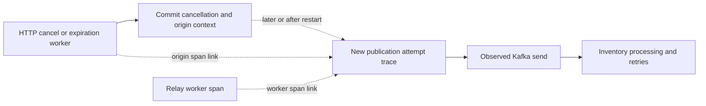

# Reservation observability design

Current API ownership and authorization are defined by [security](../security/design.md) §3–§5.
Its token-derived immutable owner, strict owner-input rejection and caller-scoped replay supersede
this feature's original pre-security assumptions. Historical delivery/acceptance notes below are
not instructions to restore anonymous access or older schemas. Verification uses the linked
current contracts in place of superseded historical assertions; earlier dated reports remain unchanged.

Status: Implemented on 2026-10-17 following the subsequent implementation request; Common integration remains a separate handoff.

## 1. Scope, ownership and compatibility

Reservation owns instrumentation and its optional outbox metadata. Common owns the shared stack,
scrape/log collection, Grafana views, alert provisioning and actual Reservation-to-Inventory
verification. The subsequent user request authorizes Reservation implementation; Common changes
remain a separate request. Follow the shared
[roadmap](../../../OBSERVABILITY_PLAN.md), Inventory's baseline and Pricing's dependency patterns.

Retain Java 25, Spring Boot 4.1.0, Resilience4j 2.4.0 and PostgreSQL 18.4. Preserve business HTTP,
DTO and OpenAPI contracts; existing local transaction boundaries, locks, idempotency replay,
FIFO outbox selection, retry policies, retention and worker budgets remain authoritative in the
creation/cancellation specs. In particular, creation retains its transaction across Inventory HTTP,
and relay retains broker acknowledgement inside its per-event database transaction.

This feature supersedes older telemetry-only descriptions of public health-only Actuator exposure,
worker-dependent backlog measurement and omission of exception messages/stacks. It adds optional
outbox context columns without changing event identity, occurrence time, payload or key. Preserve
PUT/DELETE behavior, including their existing absence of cancellation-event semantics.

Inject Micrometer APIs into the existing services; keep bean wiring in config, validated
configuration data in properties, repository access in services and outbox context fields in model.
Services and config may depend on properties; properties have no application-layer dependencies,
and services cannot depend on config. Do not introduce a general telemetry facade, Spring Security,
new layer exception, independent tracing SDK or architecture-test relaxation. Small private helpers or service-local context
records are sufficient. Use explicit Java local types and existing Mockito/Testcontainers styles.

## 2. Application baseline

AC1.1–AC1.6, AC5.1: add Boot-managed micrometer-registry-prometheus and
spring-boot-starter-opentelemetry. Reuse Inventory/Pricing's
net.ttddyy.observation:datasource-micrometer-spring-boot 2.2.1. Test dependencies follow their
Boot OpenTelemetry test starter and managed in-memory SDK exporter pattern. No stack upgrade.

| Configuration | Default / contract |
| --- | --- |
| Application port | Remains 8080; local published port remains 8082 |
| management.server.port | ${MANAGEMENT_SERVER_PORT:8087} |
| management.server.address | ${MANAGEMENT_SERVER_ADDRESS:127.0.0.1}; Compose sets 0.0.0.0 |
| Web exposure | health,prometheus only on management listener; no management host-port publication |
| Health | Hidden details; liveness=livenessState; readiness=readinessState,db |
| Application probes | /livez and /readyz remain on the application listener |
| Metrics identity | service=rent-flow-reservation; environment=${OBSERVABILITY_ENVIRONMENT:local} |
| Runtime instance | ${OBSERVABILITY_INSTANCE:${HOSTNAME:standalone}} for ECS node and OTel service.instance.id |
| OTel resource | service.name=rent-flow-reservation; deployment.environment.name from the same environment |
| Propagation | W3C; management.tracing.baggage.enabled=false |
| Sampling | management.tracing.sampling.probability=${TRACING_SAMPLING_PROBABILITY:1.0} |
| Export opt-in | management.tracing.export.otlp.enabled=${TRACING_EXPORT_ENABLED:false} |
| OTLP endpoint | ${TRACING_OTLP_ENDPOINT:http://localhost:4318/v1/traces}; HTTP/protobuf |
| Export timeouts | management.opentelemetry.tracing.export.otlp.connect-timeout=2s; timeout=2s |
| Async export | management.opentelemetry.tracing.export.max-queue-size=2048; max-batch-size=512 |
| Other export | management.logging.export.otlp.enabled=false; management.otlp.metrics.export.enabled=false |

Prometheus supplies target instance/job. Application metrics add service/environment, not a second
instance dimension. Loki stream labels are bounded service/environment; correlation and runtime
instance remain searchable fields. Keep normal JVM, Hikari and Resilience4j meters.

Enable histograms for http.server.requests, http.client.requests, reservation.creation and
reservation.inventory.claim with expected range 1ms–30s; the larger range accommodates Reservation's
five-attempt claim sequence. These bounds size buckets, not deadlines. Worker and publication
timers use 1ms–120s; publication-delay histograms use 1ms–7d. No per-identifier metric tags.

Use the existing Boot HTTP service registry and auto-configured RestClient builder. Do not manually
write traceparent headers to HTTP requests. Incoming missing/unusable context follows framework
handling. Exclude inbound /actuator and its descendants, /livez and /readyz from server observations
with the existing sibling ObservationPredicate pattern, matching path segments. Business unmatched
routes still produce observations with bounded framework metric URI labels.

JDBC configuration matches siblings: jdbc.includes=connection,query; jdbc.hikari.enabled=false;
jdbc.resultset-operations.enabled=false; jdbc.datasource-proxy.include-parameter-values=false;
query and slow-query logging disabled. Preserve connection/query parent relationships, SQL statement
attributes and ordinary database errors; do not enable Hibernate bind TRACE logs.

The application listener returns 404 for /actuator/prometheus, /actuator/health and other Actuator
endpoints; only /livez and /readyz remain public probes. No collectors, Kafka or Inventory enter
readiness or new Compose depends_on clauses. Export uses bounded asynchronous Boot infrastructure;
business code never flushes, waits for or retries collector delivery. Independent operation must
hold even with export enabled and the queue overflowing. Lost traces do not imply lost business work.

Use [Spring tracing](https://docs.spring.io/spring-boot/reference/actuator/tracing.html) and
[observability](https://docs.spring.io/spring-boot/reference/actuator/observability.html) as references;
the pinned installed artifacts determine actual configuration/API behavior.

## 3. Creation execution and committed outcomes

AC2.1–AC2.3: preserve reservation.creation.idempotency{outcome=attempt|completion|replay|busy|mismatch}.
These existing counters describe reached code paths inside the transaction. In particular,
completion is a terminal-outcome persistence attempt, not proof of commit. Do not relabel or sum
these counters to calculate successful creations.

Add reservation.creation.committed{outcome} once per newly stored terminal ledger outcome, after
the enclosing transaction commits. The finite outcome map is:

| Stored result | outcome |
| --- | --- |
| 201 | created |
| VALIDATION_FAILED | validation_failed |
| ACTIVE_RESERVATION_EXISTS | active_conflict |
| INVENTORY_ITEM_NOT_FOUND | inventory_missing |
| INVENTORY_ITEM_UNAVAILABLE | inventory_unavailable |
| INVALID_INVENTORY_REFERENCE | invalid_reference |
| Stored IDEMPOTENCY_KEY_REUSED from Inventory | key_reused |

Register a Spring TransactionSynchronization after successful terminal persistence, carrying only
the bounded outcome. Increment in afterCommit; rolled-back/failed commits do not count. Matching
replays, local mismatches and both local/Inventory busy paths register no committed counter.
An expired ledger row replaced with a new terminal result counts once for that new commit.
This is process-local telemetry: a crash after database commit but before callback can lose a
sample; it is not an exactly-once audit ledger and needs no extra durable accounting table.

Create scoped reservation.creation around ReservationCreationService.create execution. Assign
outcome from the table above, with busy, key_mismatch, unavailable, protocol_error and error for
other paths; replayed=true|false is a separate bounded tag so a replay retains its stored outcome.
For replayed=true, stored IDEMPOTENCY_KEY_REUSED uses key_reused. Unexpected failures signal
Observation.error and rethrow unchanged; known business rejections are ordinary outcomes. Record
reservation.creation.batch.size once per method invocation before work, with submitted item count,
no custom labels or summary histogram. Includes replays, contention and technical failures;
requests rejected before service invocation contribute only HTTP telemetry.

The observation timer's count/duration cover method execution, including Inventory waiting.
Its created outcome does not imply the transaction committed after method return. Commit-time
failure is visible in the HTTP server trace and absence of a committed counter increment.
Preserve transaction advice and always close scope/stop observation in finally; do not add a
second invocation counter or stretch a thread-local scope across transaction callbacks.

Callbacks used anywhere in this feature must not change a committed business response if telemetry
recording raises a RuntimeException. Keep them limited to in-memory meters and local logging,
contain such failures, and never perform repository queries, Kafka sends or collector I/O there.

## 4. Inventory dependency observations

AC2.4–AC2.5: start reservation.inventory.claim before the decorated supplier in
RestInventoryService.claim and stop after existing error decoding/translation. Tags are fixed
dependency=inventory, operation=claim and outcome from this table:

| Result | outcome | Technical observation error? |
| --- | --- | --- |
| CLAIMED / exact 204 | claimed | No |
| BUSY | busy | No |
| MISSING | missing | No |
| UNAVAILABLE business result | unavailable_items | No |
| INVALID_REFERENCE | invalid_reference | No |
| KEY_REUSED | key_reused | No |
| Circuit rejects execution | short_circuited | Yes |
| Resource access or final HTTP 5xx | unavailable | Yes |
| Malformed/unexpected response | protocol_error | Yes |
| Other unexpected escaping failure | error | Yes |

Keep CircuitBreaker outside Retry. Preserve five attempts, 200/400/800/1600ms nominal waits with
20-percent jitter, retryable resource access and 502/503/504, existing record/ignore exception
sets and public 502/503 mapping. A claim is one logical timer sample even if all attempts fail;
an open circuit yields a sample and zero HTTP calls. Local rejection/replay makes no claim sample.
Client spans/timers describe each physical attempt; the logical scope includes retry waiting.

Register callbacks once per named retry/breaker. Actual onRetry emits WARN with dependency,
failedAttempt, wait duration, bounded resource_access|upstream_5xx category and original throwable,
and adds inventory.retry to the current claim observation. Final transport/protocol failure emits
one WARN. Decoded business rejection emits no failure WARN. Do not log every short-circuited request;
its outcome plus state changes provide the signal. State changes include previousState/newState:
WARN for OPEN/FORCED_OPEN and INFO otherwise. Callbacks never alter resilience state or issue calls.

## 5. Durable cancellation and publication

### 5.1 Optional origin metadata

AC3.1, AC3.3: append V5__add_cancellation_outbox_trace_context.sql (or the next free version if
another migration ships first). Add nullable traceparent varchar(55) and tracestate varchar(512)
only to reservation.reservation_cancellation_outbox. No backfill, index, NOT NULL, default context,
payload rewrite or edit to V1–V4. Context is immutable after insertion, like event ID/key/payload.
Do not persist baggage, arbitrary request headers, full framework contexts or serialized SDK objects.

At transitionToCancelled, use the configured W3C propagator to inject the current span context
into a small temporary carrier, retaining only traceparent/tracestate within those bounds.
Persist them in the same transaction as cancellation and outbox insertion. A manual cancellation
inherits its HTTP context; timed expiration inherits the active worker context. Preserve valid
unsampled context too. If no valid context is available or instrumentation cannot serialize it,
write null context without changing cancellation. Oversize context is omitted rather than truncated.

On relay, use the configured W3C parser, not a handwritten tracing-header parser. Missing,
invalid, oversized or partially populated legacy metadata yields no usable origin link and never
blocks sending. Parsing failures produce bounded context diagnostics without dumping stored values.
Framework parsing may ignore invalid tracestate while accepting traceparent; accept its result.
Raw persisted context is not copied blindly into outgoing Kafka headers.

### 5.2 Short attempt traces and framework propagation

AC3.2–AC3.3: after FIFO selection establishes an event is due, create a new root span named
reservation.cancellation.outbox.publish for that send attempt. No attempt span/send sample is
created for EMPTY, LOCK_BUSY or BACKING_OFF. Each retry starts a new trace, linked to the same
stored origin and, when active, the current worker span (deduplicate equal links). No span is
held open while an event waits for its next attempt or while Reservation is stopped.

Use Micrometer Tracer.spanBuilder().setNoParent().addLink(Link) and the Boot-managed bridge.
Micrometer 1.7.0 provides these APIs. For link extraction, the Boot-managed OpenTelemetry W3C
propagator extracts from Context.root(), and Tracer.traceContextBuilder reconstructs the valid
origin trace ID, span ID and sampled flag for a Micrometer Link. This uses the managed SDK and
Micrometer APIs without adding a compile dependency on the runtime-scoped OTel bridge. Stored
tracestate remains available for extraction; the separate publication root does not inherit
the origin's vendor state. Do not create an artificial extraction span just to obtain its context.

Temporarily detach the ambient ObservationRegistry scope while the explicit new root is current,
so framework Kafka observations parent to the attempt rather than the worker observation.
Capture and restore the previous observation scope and close the Tracer span scope in finally
on success, error, timeout and interruption. Tests must prove distinct trace IDs and restoration;
starting a root while leaving an ambient observation active is insufficient. Keep this adjustment
local to relay sending rather than installing a general observation handler or tracing filter.

Enable spring.kafka.template.observation-enabled=true. Build a ProducerRecord containing the
unchanged UTF-8 key/payload bytes and let KafkaTemplate inject its own current tracing headers.
The send span is a child of the attempt; Inventory's existing observed listener continues that
send context, with retries/DLT following Inventory's framework behavior. Never replace Kafka's
headers with the stored origin headers, which would bypass the attempt trace.

The send-attempt span and a matching manual Timer reservation.cancellation.outbox.publish.duration
cover the send call and existing acknowledgement wait. A manual timer here is justified because
explicit span/link topology is required; do not also create a duplicate Observation timer.
Its bounded outcome is acknowledged|failed|timeout|interrupted. Preserve the original throwable
on failed spans and diagnostics. eventId, attemptNumber and originTraceId may be trace/log fields,
never metric labels. Close the span after send/wait, before transaction completion; acknowledged
means broker acknowledgement only. Failed attempts remain correlated even if their metadata
transaction later rolls back. A timeout does not prove Kafka rejected the record; duplicate
publication after a late acknowledgement remains allowed by the existing inbox contract.

Spring Kafka's normal cluster-ID discovery remains enabled; an optional actual
RESERVATION_KAFKA_CLUSTER_ID may customize KafkaAdmin.setClusterId to avoid discovery in restricted
deployments. Never use a fabricated unknown ID. The pinned Kafka 4.1.0 can synchronously discover
for up to its admin operation timeout (default 30s) and retry discovery after failure; the
five-minute discovery retry interval documented for 4.1.1 must not be assumed here. This may
extend a relay transaction before the existing send wait; it must not run on cancellation HTTP.
Do not add startup broker dependencies or change business send/backoff timeouts to mask this.

[Spring Kafka monitoring](https://docs.spring.io/spring-kafka/reference/kafka/micrometer.html)
describes observation/cluster-ID behavior; installed 4.1.0 source is authoritative for this design.
[OpenTelemetry messaging conventions](https://opentelemetry.io/docs/specs/semconv/messaging/messaging-spans/)
explain links and single-message parent relationships. The new-root outbox boundary is this
service's explicit choice; existing Inventory consumer instrumentation is unchanged.

### 5.3 Commit-aware results and delivery stages

AC3.4–AC3.5: register cancellation INFO logging only for actual transitions, using afterCommit.
Fields: eventId, reservationId, validated serialNumber, source=manual|expiration, outcome=cancelled,
and originTraceId/originSpanId when available. Repeated cancel of CANCELLED registers no new log
or context update. Rollback emits no success result. Expiration's existing transition counter
continues incrementing only after its transactional proxy successfully returns.

On acknowledgement, register afterCommit publication INFO with eventId, attemptCount,
outcome=published, recovered and captured publication traceId/spanId plus originTraceId if valid.
Log recovery in that same record, replacing the old recovery-only INFO to avoid two results.
Restore the captured span in a narrowly scoped callback for native MDC correlation if necessary;
never hold its scope open after the send. Acknowledgement followed by commit failure emits no
publication success log, counter or delay sample. The worker catch logs/counts the transaction
failure; the broker may already hold a record, so the same bytes remain eligible for retry.

Retain reservation.cancellation.outbox.publish.attempts{outcome=published|failed} and
reservation.cancellation.outbox.retries.scheduled at their existing scheduler boundaries.
published counts successful proxy returns after committed publication; failed retains its existing
inclusion of caught relay/database errors as well as failed sends. It is not a count solely of
physical Kafka attempts. Never sum it with the new send timer count as unique attempts.

Add reservation.cancellation.outbox.publication.delay, sampled once after a committed publication,
from occurredAt to the database-derived publishedAt. This measures durable local event-to-ack
time, emitted after commit; Inventory's inventory.reservation.cancellation.completion.delay
separately measures eventual release. Store delay in callback state, not a post-commit query.
Unexpected negative delay produces a clock-skew diagnostic and no sample; do not alter event time.
Publish failure/retry WARNs retain eventId, attemptCount, failureCode and nextAttemptAt and attach
the original throwable. Carry that diagnostic transiently in Result if needed; never persist it.
Restore interrupt status at the existing outer scheduler boundary after database work finishes.

## 6. Independent backlog monitoring and worker health

AC4.1–AC4.4: move backlog refresh out of relay, expiration and deletion workers. Add one service
for scheduled monitoring with four independent schedules/snapshots; keep repositories in existing
packages. No database access occurs in gauge suppliers or constructors. Configuration under
reservation.observability uses operational-backlog-fixed-delay=15s,
cleanup-backlog-fixed-delay=60s and query-timeout=5s, all positive and configurable. Run each first
refresh immediately. Snapshot families are outbox, expiration, creation_cleanup and outbox_cleanup.

Each family executes a short read-only transaction with an overall five-second default timeout
and repository query timeouts; use a single family aggregate query where needed so PostgreSQL
count, oldest timestamp and database clock form one coherent measurement. Timeout/lock waits
must actually cancel database work, not only time out a Java future. Native SQL is justified
for database clock and filtered aggregates when JPQL cannot express them safely. Reuse existing
indexes and verify plans on representative rows; add a new index only if evidence requires it.
Do not query another service's schema or change the existing business selection/locking queries.

Preserve the existing gauges:

| Snapshot | Existing gauges / meaning |
| --- | --- |
| outbox | reservation.cancellation.outbox.pending: unpublished rows; reservation.cancellation.outbox.oldest.age: seconds since oldest unpublished occurredAt |
| expiration | reservation.cancellation.expiration.overdue: HELD with holdExpiresAt <= database time; reservation.cancellation.expiration.oldest.age: seconds since oldest overdue deadline |
| creation_cleanup | reservation.creation.cleanup.expired.backlog: expired ledger rows eligible for deletion |
| outbox_cleanup | reservation.cancellation.outbox.cleanup.backlog: published rows eligible under existing 30-day retention |

Initialize counts/ages to NaN. A successful empty snapshot stores zero. Retain an immutable family
snapshot atomically: all its values and database measurement epoch-seconds update together.
Add reservation.observability.backlog.last.success.timestamp{backlog} (zero before first success)
and reservation.observability.backlog.refresh.failures{backlog}; backlog has only the four values
above. Failure preserves the entire prior snapshot and logs its exception. Age gauges are ages
at measurement, not continuously recomputed from a stale clock; dashboards must check freshness.
Use monotonic clocks for durations/budgets and database time for domain ages/deadlines.

Use two lifecycle-managed ThreadPoolTaskScheduler beans configured with Boot's scheduler builder:
taskScheduler has four threads for the existing relay, expiration and two cleanup methods;
reservationMonitoringTaskScheduler has four threads for the snapshot families. Explicitly bind
monitoring @Scheduled methods to the named monitoring scheduler and retain taskScheduler as the
default. Define both beans explicitly because providing a custom scheduler can make Boot's default
auto-configuration back off. This prevents blocked Kafka discovery/send or
cleanup from occupying monitoring capacity and prevents one failed snapshot from blocking all
families. Existing advisory/row locks and fixed-delay non-overlap remain; no parallel draining
of a single worker is introduced. Integration tests verify independent progress during a blocked
relay and preserve database-pool availability and worker coordination.

Monitor all four backlog families regardless of worker configuration, including cancellation-outbox cleanup
disabled at runtime startup. Do not condition the monitoring service on worker flags.

For each actual enabled invocation, observe reservation.worker.run{worker,outcome=success|error},
and expose reservation.worker.last.run.timestamp{worker} at start and
reservation.worker.last.success.timestamp{worker} after error-free completion (initial zero).
These worker timestamps use injectable application Clock epoch-seconds; domain ages and backlog
measurement timestamps continue to use PostgreSQL time.
An empty, lock-busy, backing-off or budget-limited normal run is successful; backlog/age describe
remaining work. A handled send failure or interruption makes the relay observation error even
though the scheduler catches it. A deletion/expiration exception makes its run error. Mark errors
before stopping observations; do not suppress business failures to make observations successful.
Preserve existing deletion counters, failure counters and duration timers alongside this run
view. Monitoring failures have their own signal and do not turn successful business runs into errors.

## 7. Structured diagnostics and collection controls

AC5.1: use Boot's ECS console encoder, disable startup banner and use SLF4J fluent key/value
fields with native traceId/spanId MDC. Start with sibling stack limits max-length=16384 and
max-throwable-depth=64, configurable through Boot. Retain ordinary messages, causes, suppressed
exceptions and frames. Existing public unexpected-error responses remain generic. Log unexpected
HTTP failures with their throwable and mark the current server observation erroneous where an
exception is handled into a response; known validation/conflict/not-found results need no WARN.

All worker/backlog catch blocks attach the original exception to a fixed message. Publication
and retry logs use bounded failure categories, retaining context without dumping request DTOs,
stored outcomes or Kafka values. Successful creation/replace/delete adds no per-request INFO;
committed cancellation/publication results follow the explicit exception in section 5.3.

| Data | Policy |
| --- | --- |
| Credentials, tokens, credential-bearing configuration | Never deliberately emit; keep automatic header capture off |
| Customer/order IDs, contact/payment fields, complete request/response bodies | No application-defined log/span fields or automatic capture |
| SQL parameters, Hibernate bind values | Capture disabled |
| Actual paths, SQL statement text and ordinary exceptions | Retain framework diagnostic content; metric labels still use templates |
| Validated equipment serial, reservation/event IDs | Permit useful searchable log/span fields; never metric/Loki labels |
| Kafka payload, raw key and arbitrary headers | No dumps or automatic capture; framework tracing headers only |
| Trace/span IDs and runtime instance | Correlation/resource fields, not Loki stream labels |
| Baggage | Disabled through Boot configuration; never persist alongside outbox context |

Set only Kafka ProducerConfig, ConsumerConfig and AdminClientConfig loggers to WARN to avoid
configuration dumps; keep operational Kafka/Hibernate diagnostics. No custom throwable printer,
recursive redactor, exporter wrapper or blanket attribute allowlist. Collection controls do not
redact arbitrary SQL literals, HTTP path values or text already in driver/third-party exceptions.
Do not deliberately place sensitive values in those surfaces; address a discovered leak using a
targeted source/framework/collector control. Common/deployment owns telemetry access and retention.

## 8. Common handoff, dashboards and provisional alerts

AC5.2: service documentation supplies a separate Common change with:

- Prometheus target reservation:8087/actuator/prometheus, job=reservation, existing 15s scrape and
  5s scrape timeout; management binds 0.0.0.0 in containers with no host publication.
- TRACING_EXPORT_ENABLED=true, TRACING_OTLP_ENDPOINT=http://rentflow-alloy:4318/v1/traces,
  configurable sampling, OBSERVABILITY_ENVIRONMENT and optional OBSERVABILITY_INSTANCE.
  RESERVATION_KAFKA_CLUSTER_ID is optional and must be the actual target broker identity.
- Existing rentflow.observability.collect=true and bounded service/environment Docker discovery
  labels; ECS traceId/spanId and originTraceId are searchable. Grafana must offer navigation from
  publication spans/logs to the linked origin trace, since trace IDs deliberately differ.
- Panels for HTTP rate/errors/p95, JVM/pool saturation, creation execution versus committed
  outcomes, logical/physical claims and retries/circuit state, pending/oldest-age publication,
  publication delay, overdue holds, worker progress, cleanup backlog and measurement freshness.

Common must not sum replicated database-backlog gauges across Reservation instances: each reports
the same schema. Use fresh per-instance snapshots and a max across fresh replicas for the service
view; show a separate unknown/stale state if none are fresh. Counters are process-local and may
be summed by rate across replicas. Keep origin/event IDs out of stream labels.

| Proposed warning | Threshold / interpretation |
| --- | --- |
| Pending cancellation age | Fresh oldest.age > 120s for 1m; includes FIFO head during backoff |
| Overdue hold age | Fresh expiration oldest.age > 30s for 30s; measures delay after hold deadline, not the 10m hold duration |
| Operational snapshot stale | Last success absent after 45s uptime or older than 45s; invalidates age-based healthy claims |
| Cleanup snapshot stale | Last success absent after 180s uptime or older than 180s |
| Publication/worker errors | Any increase surfaces in panels; sustained increase over 5m proposes a warning |

These are initial operational warnings, not SLOs. Age warnings remain visible even if the worker
is disabled. Worker run/success timestamps provide diagnostic context interpreted against deployment
configuration and scheduling cadence; the proposed warnings use backlog age, measurement freshness
and execution errors. Monitoring-stale alerts are independent of worker flags.
Route/rate-limit notifications in Common after baseline
measurement; no alert provisioning is performed in this service specification.

Investigation examples: follow a slow creation from server span into JDBC and logical Inventory
claim, then compare physical attempts and wait events; locate stalled cancellation via fresh
oldest age, eventId and failed attempt logs, follow the origin link and Inventory processing;
after a restart, confirm the same durable origin link on a new publication trace. Kafka producer
acknowledgement or publication delay cannot prove release: use Inventory's completion-delay/
outcome signals, consumer lag and DLT diagnostics supplied by Inventory/Common. No additional
Inventory read or acknowledgement protocol is introduced for observability.

## 9. Verification and rollout

AC5.3: preserve unit tests without Spring context and Mockito; use existing PostgreSQL and Kafka
Testcontainers plus Boot-managed in-memory SpanData export for integration tests. Real HTTP test
servers may capture Inventory requests; actual cross-service propagation belongs to Common.

- Real application/management random ports prove exposure/isolation, hidden health, app probes,
  service/environment identity, JVM/pool/HTTP histograms, excluded scrapes/probes and OpenAPI
  regression. Verify default export off and malformed/missing W3C context plus disabled baggage.
- Creation table in section 3: assert per-invocation old-counter deltas, committed-counter deltas,
  batch summary and execution observations. Force transaction rollback and commit-time failure
  after terminal persistence, including outer-transaction rollback and expired-row replacement.
  A matching replay, local mismatch and Inventory/local busy never add a committed sample.
- Claim table in section 4: verify outcomes, error flags, attempt counts, retry waits/events,
  once-registered callbacks, propagated trace IDs and unchanged statuses/decorator order. Open
  circuit makes zero calls; replay/local rejection has no claim observation. Scope never leaks.
- Migration upgrade from V4 preserves every existing payload/key/state; optional context is null
  on old rows. New manual/expiration rows persist origin in the same transaction and no baggage.
  Missing/invalid/oversize context and zero sampling do not stop processing.
- Real Kafka verifies exact key/value bytes, observed send headers, failure/timeout/interruption,
  retries and scope restoration. Restart the application context with the same PostgreSQL data
  and no in-memory origin state, then prove a new attempt trace links to the original stored
  trace/span IDs. Two attempts have distinct trace IDs and the same origin link. An observed
  test consumer proves outgoing context; Common verifies real Inventory retries/DLT/release.
- Assert cancellation/publication INFO only after commit and once per actual committed result;
  rollback/no-op emits none. Broker acknowledgement followed by failed DB commit has an
  acknowledged span but no published counter/INFO/delay and later retries identical bytes.
  Verify late Kafka success after timeout remains safe; injected counter/log callback failures
  cannot turn committed work into an HTTP failure. Interruption is restored at the outer boundary.
- Deterministic clocks verify NaN/empty/last-good snapshots, query cancellation at five seconds,
  atomic family publication, database ages, configured schedules and worker activity timestamps.
  A blocked relay cannot starve all monitoring or expiration. Disabled workers still expose
  backlog; caught send/delete/expiration failures yield error observations and no success update.
- Serialize actual ECS callback logs, asserting native messages/causes/stacks and useful fields.
  Use synthetic customer subjects in authenticated JWT fixtures or persisted reservation fixtures,
  and order/body-only values in valid requests, plus credential/query/header/SQL-parameter sentinels,
  to prove successful-path custom diagnostics and capture exclusions. Do not supply customerId or
  customerIssuer as valid creation/replacement inputs; both fields must be rejected.
  Do not assert universal redaction of accepted paths/SQL literals/arbitrary exception messages.
- With OTLP enabled, exercise refused and slow HTTP collectors and bounded queue overflow using
  small test-only queue sizes; creation, cancellation commits, relay business state and readiness
  retain behavior without request-coupled exporter delay. No broad timeout increases or skips.
- Keep the existing standalone container smoke workflow, Inventory fixture, persistence/restart,
  CRUD and DB-outage probes. Extend only management isolation checks and necessary existing
  health assertions; do not add telemetry backends or claim Common acceptance from this smoke.

Every implementation increment runs mvn -B -ntp clean verify on Java 25 with Docker and confirms
BUILD SUCCESS, without skipped tests/checks. Final service implementation additionally runs
./scripts/container-smoke-test.sh. The earlier specification-only stage exposed fixed October
1–3 test fixtures that had become past dates. Implementation replaces successful-create fixtures
with UTC-relative dates and keeps the existing validation and persistence assertions; the OpenAPI
replacement example remains checked as written while its prerequisite creation uses future dates.
No application date-validation rule changes. The migration-history assertion now explicitly
includes V5, and the V4 upgrade test proves optional context leaves legacy bytes/state unchanged.

Final Reservation acceptance on 2026-10-17: Java 25 mvn -B -ntp clean verify reported
BUILD SUCCESS with 78 unit/architecture tests and 177 integration tests, zero failures, errors
or skips. ./scripts/container-smoke-test.sh reported Container smoke test passed and removed
its isolated containers and volume. It covered the production image, unpublished management
port, application Actuator isolation, creation/replay, Inventory outage/recovery, application and
stack restart persistence, database readiness/liveness behavior, replacement and deletion.
Focused regressions covered real application-context restart correlation, an observed Kafka
consumer, acknowledgement followed by commit failure, legacy/invalid/unsampled origins, late
acknowledgement after timeout/interruption, independent monitoring with database-enforced timeout,
committed outcome accounting, ECS capture controls and enabled-export refusal/slow delivery/queue
overflow. Common collection, real Inventory/Grafana workflows and alert provisioning remain the
separate handoff in section 8.

## 10. Requirements traceability

| Acceptance criteria | Design sections | Tasks |
| --- | --- | --- |
| AC1.1 | §2, §8, §9 | T1, T8 |
| AC1.2 | §1, §2, §4, §5, §6, §9 | T1–T8 |
| AC1.3 | §2, §7, §8, §9 | T1, T7, T8 |
| AC1.4, AC1.6 | §2, §4, §9 | T1, T3, T7 |
| AC1.5 | §2, §9 | T1, T7 |
| AC2.1 | §2, §3, §5, §6, §9 | T2, T3, T5, T6 |
| AC2.2, AC2.3 | §3, §9 | T2 |
| AC2.4, AC2.5 | §4, §9 | T3 |
| AC3.1 | §5.1, §9 | T4 |
| AC3.2, AC3.3 | §5.1, §5.2, §5.3, §9 | T4, T5 |
| AC3.4, AC3.5 | §5.3, §7, §9 | T5, T7 |
| AC4.1–AC4.4 | §6, §8, §9 | T6 |
| AC5.1 | §2, §5, §7, §9 | T1, T3, T5, T6, T7 |
| AC5.2 | §8 | T8 |
| AC5.3 | §9 | T7, T8 |
