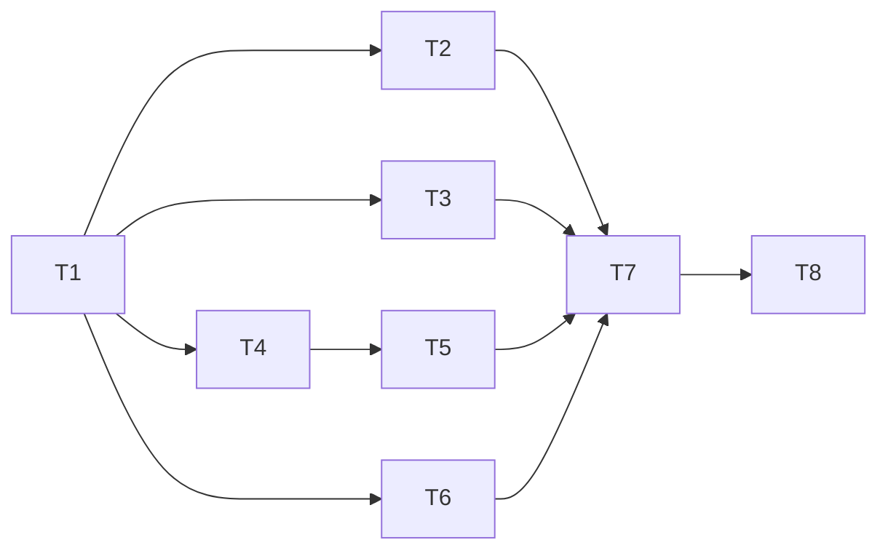

# Reservation observability implementation tasks

Current API ownership and authorization are defined by [security](../security/design.md) §3–§5.
Its token-derived immutable owner, strict owner-input rejection and caller-scoped replay supersede
this feature's original pre-security assumptions. Historical delivery/acceptance notes below are
not instructions to restore anonymous access or older schemas. Verification uses the linked
current contracts in place of superseded historical assertions; earlier dated reports remain unchanged.

Status: Implemented on 2026-10-17 following the subsequent implementation request. Final acceptance is recorded in design.md §9.

Each task is one safe commit in rent-flow-reservation and includes meaningful tests of its own
behavior. Do not defer that task's regression tests to T7. Every task runs Java 25
mvn -B -ntp clean verify with Docker and requires BUILD SUCCESS without skips. Common integration
is a separate repository request; T8 supplies its concrete handoff, not a Common commit.

Dependencies are explicit below. T2, T3, T4 and T6 may follow T1 independently; T5 needs T4's schema
and propagation metadata. Later testing/documentation consumes all relevant preceding increments.

## T1 — Establish the shared application baseline

**State:** Implemented; final acceptance is recorded in design.md §9.

**Commit:** build: add reservation observability baseline

**Depends on:** None.

**Refs.** requirements.md AC1.1–AC1.6, AC5.1; design.md §1, §2, §7, §9.

**Scope.** Add the sibling-managed Prometheus/OTel and pinned JDBC integration, ECS configuration,
private management listener, observation exclusions and in-memory exporter test support. Configure
Reservation identity and Compose management binding without host publication or collector dependencies.

**DoD.**

- Real-port integration tests prove only management health/Prometheus are exposed on port 8087's
  configurable listener, application Actuator paths return 404, /livez and /readyz retain their
  statuses/hidden details, and readiness remains database-only even with Kafka/collector absent.
- Tests prove service/environment/resource instance identity, bounded HTTP metric route labels,
  JVM/pool meters and histogram buckets, JDBC query/connection parentage and excluded probes/scrapes.
- Known, absent and unusable W3C inputs preserve processing; successful traces omit baggage,
  headers/bodies/query strings and bound SQL parameter values under the documented capture policy.
- Native ECS serialization retains trace/span correlation and ordinary exception causes/stacks;
  default OTLP export is disabled and no second SDK/security dependency is introduced.
- Existing business/OpenAPI/persistence tests pass; mvn -B -ntp clean verify reports BUILD SUCCESS.

## T2 — Separate creation execution from committed terminal outcomes

**State:** Implemented; final acceptance is recorded in design.md §9.

**Commit:** feat: observe reservation creation outcomes

**Depends on:** T1.

**Refs.** requirements.md AC1.2, AC2.1–AC2.3; design.md §3, §9.

**Scope.** Add scoped creation execution, batch summary and after-commit bounded outcome counters
at the existing persistence boundary, preserving old counter meanings and transaction advice.

**DoD.**

- Tests cover every stored outcome in design.md §3, each nonterminal path, replayed outcome tags,
  exception classification, scope restoration and one submitted batch-size sample per invocation.
- Integration tests prove one committed sample for fresh/expired replacement terminal writes and
  zero for matching replay, local mismatch, local/Inventory busy, rollback and commit-time failure.
- Forced outer-transaction rollback after service return proves a method-created sample cannot
  become a committed count; prior idempotency counters keep their original per-path deltas.
- Injected telemetry callback failure cannot change an already committed response or DB state;
  no new success-creation INFO logs or audit table appear.
- mvn -B -ntp clean verify reports BUILD SUCCESS.

## T3 — Observe complete Inventory claim sequences

**State:** Implemented; final acceptance is recorded in design.md §9.

**Commit:** feat: trace reservation inventory claims

**Depends on:** T1.

**Refs.** requirements.md AC1.2, AC1.4, AC1.6, AC2.1, AC2.4, AC2.5, AC5.1; design.md §4, §7, §9.

**Scope.** Add one logical claim observation, once-registered retry/breaker diagnostics and retry
events around the existing decorators and decoding. Reuse the observed Boot HTTP-service client.

**DoD.**

- Scripted real HTTP capture tests assert every claim outcome/error flag from design.md §4 and
  one logical sample spanning retry waits, with correct physical attempt count and propagated IDs.
- Retry selection, five-attempt limit, nominal delays/jitter, CircuitBreaker-outside-Retry,
  exception translation and public statuses are unchanged; open circuit performs zero HTTP calls.
- Replay/local rejection produces no logical claim. Retry events occur only for actual scheduled
  retries, callbacks register once, circuit transition severity/fields match design and scopes restore.
- ECS logs retain original retry/final-failure causes without deliberate response-body/key dumps;
  expected business rejections add no failure WARN and existing Resilience4j meters retain meanings.
- mvn -B -ntp clean verify reports BUILD SUCCESS.

## T4 — Persist optional cancellation origin context

**State:** Implemented; final acceptance is recorded in design.md §9.

**Commit:** feat: persist cancellation outbox trace context

**Depends on:** T1.

**Refs.** requirements.md AC1.2, AC3.1, AC3.3, AC5.1; design.md §5.1, §9.

**Scope.** Append the next migration for nullable traceparent/tracestate, map immutable optional
entity metadata and capture only available configured W3C context during existing cancellation.

**DoD.**

- Upgrade-from-V4 and fresh-schema tests verify new nullable bounded columns only in reservation,
  unchanged earlier migration checksums and byte-for-byte old payload/key/state preservation.
- Manual and expiration paths persist their current origin atomically with status/event; rollback
  leaves neither transition nor context/event, and concurrent/no-op cancellation retains one event.
- No-context, valid unsampled context, oversize context and instrumentation capture failure remain
  cancellable; no baggage/arbitrary headers/customer/order data enter metadata. No fabricated origin.
- Existing Kafka event version, fields, key bytes and payload bytes remain unchanged.
- mvn -B -ntp clean verify reports BUILD SUCCESS.

## T5 — Correlate publication attempts and committed cancellation results

**State:** Implemented; final acceptance is recorded in design.md §9.

**Commit:** feat: trace durable cancellation publication

**Depends on:** T4.

**Refs.** requirements.md AC1.2, AC2.1, AC3.2–AC3.5, AC5.1; design.md §5.2, §5.3, §7, §9.

**Scope.** Enable framework Kafka observations, create short new-root linked attempts, preserve
legacy-context processing, add send duration/publication delay and committed INFO results with
transient exception diagnostics. Keep scheduler metrics, FIFO/backoff and interrupt boundaries.

**DoD.**

- Real-Kafka tests prove a new trace per due send, origin/worker links, a child send and observed
  consumer context, exact key/value bytes and scope restoration on every attempt exit path.
- Context restart with retained PostgreSQL data and no in-memory origin reproduces the original
  link; two attempts use different trace IDs with the same origin trace/span IDs. Legacy/null,
  malformed/oversized/partial context and zero sampling never prevent sending.
- EMPTY/LOCK_BUSY/BACKING_OFF produce no send sample; failed/timeout/interrupted sends carry
  the original exception and correct timer outcome. Broker outage preserves HTTP cancellation.
- Committed cancellation/publication each emit one INFO result; no-op/rollback emits none;
  recovery uses the same publication record. Publication delay uses DB timestamps after commit.
- Broker acknowledgement followed by DB commit failure yields no published success counter/log/
  delay, retains retryable bytes and later safely republishes. Late acknowledgement after timeout,
  retry backoff, FIFO locking, at-least-once behavior and interrupt restoration retain regressions.
- Existing publication/retry meters keep their previous deltas, telemetry callback failure cannot
  change committed work, and cluster-ID behavior follows pinned 4.1.0 with optional actual-ID override.
- mvn -B -ntp clean verify reports BUILD SUCCESS.

## T6 — Monitor backlog independently and expose worker progress

**State:** Implemented; final acceptance is recorded in design.md §9.

**Commit:** feat: monitor reservation backlog and worker health

**Depends on:** T1.

**Refs.** requirements.md AC1.2, AC2.1, AC4.1–AC4.4, AC5.1; design.md §6, §7, §9.

**Scope.** Move measurement into four independently scheduled bounded snapshot refreshes; retain
gauge names and worker deletion/business schedules. Add freshness/error/progress signals,
dedicated monitoring scheduler capacity and explicit worker observations including caught failures.

**DoD.**

- Tests assert initial NaN, empty zero, coherent snapshot updates, DB-clock ages, preserved last-good
  values/timestamps on error, failure-counter deltas and attached exceptions for all four families.
- Defaults are 15s operational and 60s cleanup with immediate first runs and positive-property
  validation. Real PostgreSQL timeout tests cancel each blocked snapshot within its configured
  five-second database budget; a scrape issues no SQL.
- Blocked relay/send cannot starve monitoring or expiration; separate scheduler wiring, default
  worker capacity and measurement with workers disabled are covered without changing lock safety.
- Disabled relay/expiration/outbox cleanup still expose their DB backlog. Worker
  run/success timestamps and success/error observations cover normal empty/backoff/budget stops,
  send failure/interruption and caught expiration/deletion errors with no false success updates.
- Existing cleanup/expiration/publication meter semantics, retention/chunks and transaction budgets
  retain regression assertions; monitoring failure does not mark completed business work failed.
- mvn -B -ntp clean verify reports BUILD SUCCESS.

## T7 — Verify exporter failure isolation and diagnostic boundaries

**State:** Implemented; final acceptance is recorded in design.md §9.

**Commit:** test: verify reservation telemetry failure isolation

**Depends on:** T2, T3, T5, T6.

**Refs.** requirements.md AC1.2, AC1.3, AC1.5, AC1.6, AC3.4, AC3.5, AC5.1, AC5.3; design.md §2, §5.3, §7, §9.

**Scope.** Add focused cross-cutting regression scenarios with enabled OTLP, real serialized ECS
events and bounded test queues, building on each task's existing behavior coverage.

**DoD.**

- Refused and slow HTTP collectors plus demonstrated queue saturation preserve creation/cancellation
  commits, relay state transitions and readiness without collector-dependent business latency.
- Real ECS diagnostics retain useful exception messages/causes/stacks, native span IDs and captured
  publication correlation after commit; handled unexpected HTTP errors mark server traces erroneous
  and keep generic public responses.
- Sentinels in customer identity fixtures (verified token subjects or persisted owners), order/body
  fields, headers/query values, credentials and bound SQL values
  stay absent from successful-path custom telemetry/captured attributes as specified; no test
  invents universal redaction of allowed paths, SQL literals or arbitrary exception messages.
- Assert bounded metric labels, disabled baggage, management/probe exclusion and absence of new
  success logs for ordinary creation/replace/delete. Existing architecture rules pass unchanged.
- mvn -B -ntp clean verify reports BUILD SUCCESS without skips or weakened assertions.

## T8 — Document the Common handoff and complete service acceptance

**State:** Implemented; final acceptance is recorded in design.md §9.

**Commit:** docs: document reservation observability operations

**Depends on:** T7.

**Refs.** requirements.md AC1.1–AC1.3, AC5.2, AC5.3; design.md §8, §9, §10.

**Scope.** Document configuration, metric semantics, linked-trace investigation, provisional alerts
and the separate Common checklist. Extend the existing smoke for private management exposure while
preserving its existing standalone workflow and fixture; add no telemetry stack to this repository.

**DoD.**

- README/service docs list the exact scrape target, environment/resource/log contract, bounded
  labels, export defaults, optional actual Kafka cluster ID and all metric meanings/overlap rules.
- Documentation contains slow creation, stalled cancellation and restart investigations, linked
  origin navigation, Inventory completion versus acknowledgement, fresh-replica backlog aggregation
  and every threshold/grace rule from design.md §8; Common work remains unclaimed.
- Container smoke passes existing persistence/restart/CRUD/outage checks plus unpublished management
  port and public Actuator 404 checks; no collector or Grafana instance is required.
- Spec traceability and a dated self-evaluation report identify acceptance coverage accurately;
  implementation status is updated only to reflect actual completed and verified tasks.
- mvn -B -ntp clean verify reports BUILD SUCCESS and ./scripts/container-smoke-test.sh passes.
